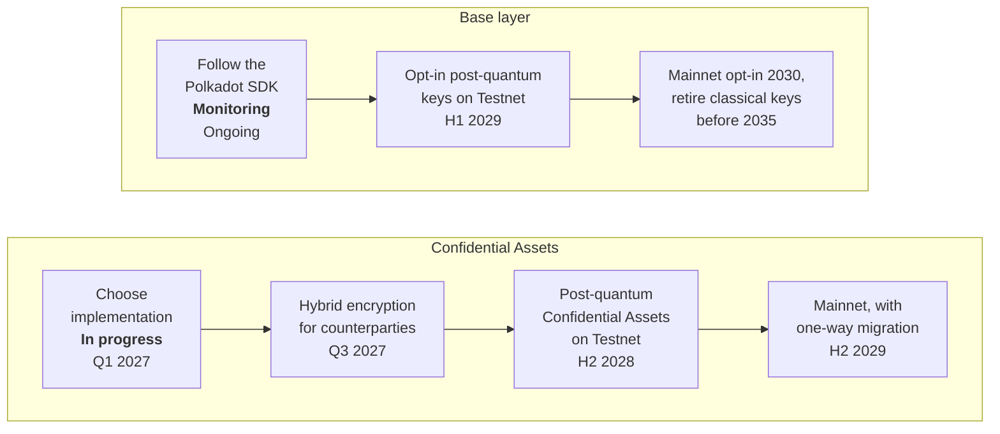

# Post-Quantum Readiness

> How Polymesh is preparing its cryptography for quantum computing

:::info Last updated
20 November 2026. We update this page whenever a stage or target changes.
:::

## Summary

- **No quantum computer today can break the cryptography Polymesh uses.** Estimates of when one might exist vary, and recent research has brought them earlier. We are preparing now so that Polymesh can move well before it matters.
- **We are adopting post-quantum cryptography in stages.** Each stage has an indicative target date and clear criteria for moving forward. Several steps build on NIST's post-quantum standards and on the Polkadot SDK's post-quantum upgrades, which we adopt as they are released, so each stage completes when its criteria are met and the dates may move.
- **The base layer follows Polkadot.** Polymesh is built on the Polkadot SDK, and we will adopt the post-quantum account, validator and networking upgrades developed for it.
- **Confidential Assets need their own work, and it is under way.** We have built a proof of concept that replaces each elliptic-curve component of Confidential Assets with a post-quantum one. A first hardening step works with the current protocol; full protection against "harvest now, decrypt later" comes with the post-quantum protocol.
- **Integrators don't need to do anything today.** Existing keys and signatures will keep working throughout the transition.

## Our approach

We follow five principles:

- **Standards first.** We use algorithms standardised by NIST, which institutions, hardware wallets and HSMs are adopting:
  - **Signatures:** ML-DSA ([FIPS 204](https://csrc.nist.gov/pubs/fips/204/final)) by default. Where needed, FN-DSA (Falcon, FIPS 206) once it is final, for signatures about a quarter of the size, and SLH-DSA ([FIPS 205](https://csrc.nist.gov/pubs/fips/205/final)), which is hash-based and so does not depend on the lattice assumptions behind ML-DSA and FN-DSA.
  - **Encryption and key exchange:** ML-KEM ([FIPS 203](https://csrc.nist.gov/pubs/fips/203/final)). NIST has selected HQC, a code-based scheme, as a backup in case ML-KEM is ever broken.
  - **Zero-knowledge proofs:** there is no post-quantum standard yet. We use hash-based or lattice-based proofs, which do not rely on elliptic curves.
- **Hybrid during the transition.** Where practical, post-quantum and classical cryptography run together, so security never depends on a newer algorithm alone.
- **Opt-in before mandatory.** Post-quantum keys will be available as an option well before classical keys are retired.
- **Crypto agility.** We design for algorithms to be replaced, not for one algorithm to last forever.
- **No premature slowdown.** Post-quantum signatures and proofs are much larger than today's, and slower to produce. We will not reduce network performance before the risk justifies it.

We plan against published standards timelines rather than predictions of quantum hardware. NIST's final transition plan deprecates quantum-vulnerable public-key algorithms, including the elliptic-curve signatures most blockchains use, after 2030, and disallows them after 2035 ([NIST IR 8547](https://csrc.nist.gov/pubs/ir/8547/final)). Our targets below are set against those dates.

## What is already quantum-resistant

Quantum computers mainly threaten **public-key** cryptography: signatures, key exchange and public-key encryption. Hash functions are much less affected. The hashing behind Polymesh's block and state integrity (BLAKE2b-256) is considered quantum-resistant at its current size, and does not need to change.

## What needs to change

| Area                                        | Today                                                            | Post-quantum direction                                                                                             |
| ------------------------------------------- | ---------------------------------------------------------------- | ------------------------------------------------------------------------------------------------------------------ |
| Account and identity keys                   | Ed25519, SR25519, ECDSA signatures                               | ML-DSA keys added alongside existing ones, then FN-DSA once final; existing keys can rotate to them                |
| Node operator keys and finality             | Elliptic-curve session keys                                      | ML-DSA, following the Polkadot SDK                                                                                 |
| Block production randomness                 | Elliptic-curve VRF (BABE)                                        | Hash-based randomness, following the Polkadot SDK                                                                  |
| Network transport                           | Elliptic-curve key exchange                                      | Hybrid key exchange, combining elliptic-curve key exchange with ML-KEM                                             |
| [Confidential Assets](/confidential-assets) | Elliptic-curve encryption, commitments and zero-knowledge proofs | ML-KEM encryption, ML-DSA authorization and post-quantum zero-knowledge proofs (see [below](#confidential-assets)) |

## Base layer: aligned with Polkadot

Polymesh is built on the Polkadot SDK. Web3 Foundation has published a [post-quantum roadmap for Polkadot](https://forum.polkadot.network/t/post-quantum-cryptography-roadmap-for-polkadot-and-jam/13232) covering account signatures, validator keys, block production randomness and networking. We will adopt those upgrades as they become available, then integrate them with Polymesh's identity and compliance model.

Polymesh's identity model makes key migration simpler. A Polymesh identity is not tied to a single key: [primary keys](/identity/advanced/primary-keys) can be rotated through an [authorization](/authorizations), and [secondary keys](/identity/advanced/secondary-keys) can be added and removed. We expect holders to move to post-quantum keys without changing their identity or losing their claims:

- **Assets in an identity's portfolios** belong to the identity, not to a key, so they do not move.
- **Assets held directly by an account** must be moved before the old key is removed, because a key can't be unlinked from its identity while it holds assets.
- **POLYX** stays with the key that holds it. The old key can still transfer it, so holders should move it to the new key rather than leave it on a key that could one day be forged.

A key rotation is authorized by the current, classical key, so it is only safe while that key cannot be forged. This is why post-quantum keys will be available well before a quantum computer is expected to exist.

## Confidential Assets

Confidential Assets raise a different kind of quantum risk.

For **signatures**, the risk is future forgery. A quantum computer could one day forge a signature, but it cannot go back and change transactions already finalised. Moving to post-quantum keys before such a computer exists removes the risk.

For **encryption**, the risk is "harvest now, decrypt later". Confidential Assets encrypt settlement details so that only the parties, auditors and mediators can read them. Someone could store encrypted data today and decrypt it once a large quantum computer exists. For confidential data that must stay private for years, this is the risk that matters most.

We are addressing the risk in two steps.

**1. Hybrid encryption for counterparties.** The sender and receiver of a settlement each decrypt its details and check them before they affirm. Their copies can move to hybrid encryption, which combines today's elliptic-curve key exchange with ML-KEM-768 following [NIST SP 800-227](https://nvlpubs.nist.gov/nistpubs/SpecialPublications/NIST.SP.800-227.pdf). Those copies then stay private unless both schemes are broken. This step works with the current Confidential Assets protocol, so it does not wait for the full upgrade.

Auditor copies are not part of this step. Auditors don't affirm a settlement, so the protocol itself must prove that each auditor's copy is correct, and today's elliptic-curve proofs can't prove that for ML-KEM encryption. Every settlement has at least one auditor copy, and until step 2 those copies use elliptic-curve encryption only. Step 1 therefore hardens the protocol but does not on its own remove the "harvest now, decrypt later" risk.

**2. A fully post-quantum Confidential Assets protocol.** The full upgrade replaces each elliptic-curve component, and removes the "harvest now, decrypt later" risk:

- **Proofs:** hash-based or lattice-based zero-knowledge proofs, which need no elliptic curves and no trusted setup.
- **Auditor copies:** encrypted with ML-KEM, with the proof itself guaranteeing that each auditor can decrypt exactly the settlement it attests to.
- **Authorization:** ML-DSA signatures, so HSMs and institutional custody can authorize confidential transactions with standard post-quantum keys.
- **Migration:** existing confidential balances move to the new version through a one-way migration, with supply tracked per asset.

We have built a proof of concept that replaces each elliptic-curve component with a post-quantum one. We are now comparing it with an alternative implementation before choosing one to take to Testnet.

## Stages

The two areas move independently. Confidential Assets work is led by Polymesh; base-layer work follows the Polkadot SDK.

| Area                | Stage                                       | Status      | Target\*                                | Moves forward when                                                                                                             |
| ------------------- | ------------------------------------------- | ----------- | --------------------------------------- | ------------------------------------------------------------------------------------------------------------------------------ |
| Confidential Assets | Choose implementation                       | In progress | Q1 2027                                 | One of the two implementations is chosen for Testnet                                                                           |
| Confidential Assets | Hybrid encryption for counterparties        | Planned     | Q3 2027                                 | Implemented and audited on the current protocol                                                                                |
| Confidential Assets | Post-quantum Confidential Assets on Testnet | Planned     | H2 2028                                 | The full protocol is implemented and independently audited                                                                     |
| Confidential Assets | Mainnet, with one-way migration             | Planned     | H2 2029                                 | Testnet validation is complete and integrators are ready                                                                       |
| Base layer          | Follow the Polkadot SDK                     | Monitoring  | Ongoing                                 | Post-quantum key support is available in the Polkadot SDK                                                                      |
| Base layer          | Opt-in post-quantum keys on Testnet         | Planned     | H1 2029                                 | Integrated with Polymesh identities and audited                                                                                |
| Base layer          | Mainnet opt-in, then retire classical keys  | Planned     | Opt-in 2030; classical keys before 2035 | Wallets, custodians and integrators are ready. Classical keys are retired only after a long opt-in period, with advance notice |

\* Target dates are indicative and subject to change without notice. They reflect our current planning and are not a commitment. Base-layer dates depend on the Polkadot SDK and on standards bodies, and move with them. We will update this page whenever a stage or target changes.

## Trade-offs

Post-quantum security costs space and computation. Signatures are about 10 to 50 times larger than today's:

| Signature scheme          | Signature size  |
| ------------------------- | --------------- |
| Ed25519 / SR25519 (today) | 64 bytes        |
| FN-DSA-512 (Falcon)       | about 666 bytes |
| ML-DSA-44                 | 2,420 bytes     |
| ML-DSA-65                 | 3,309 bytes     |

Post-quantum zero-knowledge proofs are also larger and slower to generate than today's. Expect post-quantum transactions to be bigger, and to cost more, than classical ones at first. This is the main reason we introduce post-quantum cryptography in stages and as an option first.

## What integrators should do now

No action is required today. To make the transition easy when it comes:

- **Don't hard-code key or signature sizes.** Post-quantum keys and signatures are much larger than today's 32- or 33-byte public keys and 64- or 65-byte signatures.
- **Keep signing behind an abstraction** so you can add a new key type without reworking your integration.
- **Make sure you can rotate keys.** Confirm that your custody setup can rotate primary keys and add secondary keys on your identities.
- **Watch this page** and the [changelogs](/development/changelogs) for new key types as they reach Testnet.

## Further reading

- [NIST post-quantum cryptography project](https://csrc.nist.gov/projects/post-quantum-cryptography)
- [NIST IR 8547: Transition to Post-Quantum Cryptography Standards](https://csrc.nist.gov/pubs/ir/8547/final)
- [Post-Quantum Cryptography Roadmap for Polkadot and JAM](https://forum.polkadot.network/t/post-quantum-cryptography-roadmap-for-polkadot-and-jam/13232)
- [Confidential Assets](/confidential-assets)
